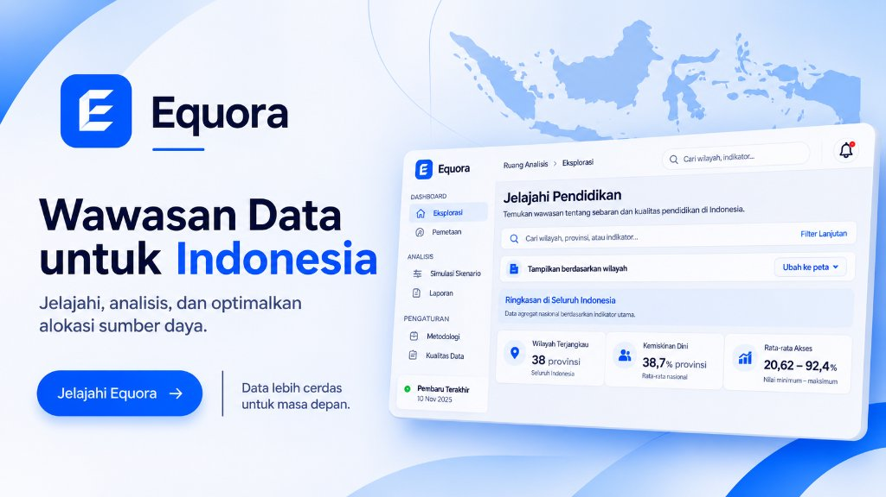
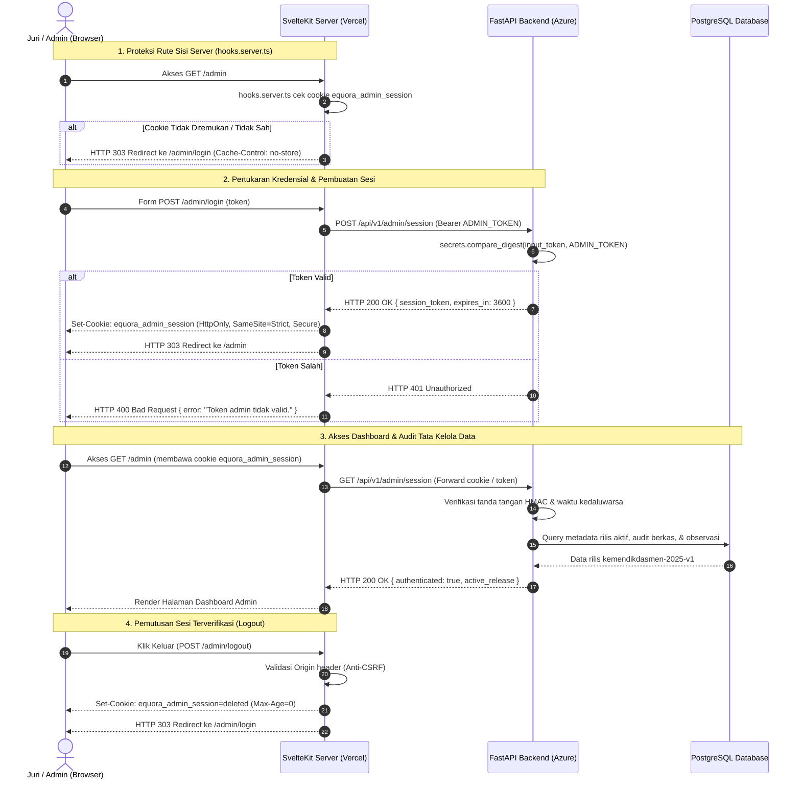

<p align="center">
  
</p>

<h1 align="center">Equora</h1>

<p align="center">
  Memahami akses fasilitas pendidikan.<br>
  Menelusuri data daerah dan mencoba prioritas alokasi yang dapat dijelaskan.
</p>

<p align="center">
  
  
  
  
  
</p>

<p align="center">
  <a href="#panduan-review-juri-live-demo">Review Juri</a> ·
  <a href="#fitur">Fitur</a> ·
  <a href="#arsitektur--keamanan-admin">Keamanan Admin</a> ·
  <a href="#cicd--deployment-otomatis">CI/CD</a> ·
  <a href="#variabel-lingkungan-environment">Environment</a> ·
  <a href="#progress-saat-ini">Progress</a> ·
  <a href="#bahasa-dan-teknologi">Teknologi</a> ·
  <a href="#menjalankan-proyek">Instalasi</a> ·
  <a href="#struktur-repository">Struktur</a> ·
  <a href="#tim-dan-kontribusi">Tim</a>
</p>

<p align="center">
  
</p>

## Tentang proyek

Equora adalah aplikasi web untuk mengeksplorasi data fasilitas pendidikan di Indonesia, membandingkan kondisi antardaerah, dan menguji skenario alokasi sumber daya. Pengguna dapat menelusuri sumber indikator, mengubah asumsi simulasi, lalu membandingkan hasilnya.

Proyek ini disiapkan untuk Web In Action (WIA), MIA 2026. Antarmuka menggunakan Bahasa Indonesia, dengan penjelasan untuk publik serta rincian metode, sumber, dan batas data.

> **Status Deployment:** Layanan Equora beroperasi **penuh secara live** (*production-ready*). Frontend di-deploy pada domain resmi [www.equora.web.id](https://www.equora.web.id) (Vercel Edge Network) dan terhubung langsung ke backend API FastAPI pada **Azure Container Apps** (`equora-api` di `rg-group`) dengan database PostgreSQL terkelola.
>
> Seluruh alur publik (Profil Daerah, Explorer GIS, Studio Optimasi CP-SAT, Compare & Ekspor PDF) serta modul administrasi tata kelola data (`/admin`, `/admin/login`) dapat langsung diuji secara daring.

## Panduan Review Juri (Live Demo)

Bagian ini dirancang khusus bagi dewan juri untuk mengevaluasi fungsionalitas, alur administrasi, dan ketahanan sistem secara langsung pada lingkungan *production*.

### Tautan Akses Langsung Evaluasi

| Komponen | Tautan | Keterangan & Kredensial |
| --- | --- | --- |
| **Aplikasi Frontend (Domain Resmi)** | [www.equora.web.id](https://www.equora.web.id) | Antarmuka pengguna produksi utama (Vercel Edge Network). Akses publik tanpa perlu login. |
| **Aplikasi Frontend (Mirror)** | [equora-tau.vercel.app](https://equora-tau.vercel.app) | URL deployment sekunder Vercel. |
| **Backend API Gateway** | [equora-api.bravecliff-18f241ae.japaneast.azurecontainerapps.io](https://equora-api.bravecliff-18f241ae.japaneast.azurecontainerapps.io) | API FastAPI pada Azure Container Apps. |
| **Dokumentasi Interaktif API** | [equora-api.bravecliff-18f241ae.japaneast.azurecontainerapps.io/docs](https://equora-api.bravecliff-18f241ae.japaneast.azurecontainerapps.io/docs) | Swagger UI / OpenAPI docs interaktif. |
| **Health & Readiness Check** | [www.equora.web.id/api/v1/health/ready](https://www.equora.web.id/api/v1/health/ready) | Verifikasi konektivitas backend dan PostgreSQL (`200 OK`). |
| **Endpoint Geometri Publik** | [www.equora.web.id/api/v1/geometry](https://www.equora.web.id/api/v1/geometry) | Data batas wilayah provinsi untuk visualisasi GIS (`200 OK`). |
| **Halaman Login Admin** | [www.equora.web.id/admin/login](https://www.equora.web.id/admin/login) | Form autentikasi admin. **Token Evaluasi:** `yJup-kHjZnqEqqLf2VXl_ciiGWTi0e8BT2XtyVXPdKQ` |
| **Dashboard Admin Terlindungi** | [www.equora.web.id/admin](https://www.equora.web.id/admin) | Dashboard tata kelola data (terproteksi, dialihkan ke login jika belum ada sesi). |

> 🔑 **Kredensial Pengujian Administrator (Khusus Evaluasi Dewan Juri):**
> - **URL Halaman Login:** [https://www.equora.web.id/admin/login](https://www.equora.web.id/admin/login) *(Mirror: [https://equora-tau.vercel.app/admin/login](https://equora-tau.vercel.app/admin/login))*
> - **Admin Token Evaluasi:** `yJup-kHjZnqEqqLf2VXl_ciiGWTi0e8BT2XtyVXPdKQ`
> 
> *Dewan juri dapat menggunakan token di atas untuk menguji alur otentikasi admin, validasi checksum data, dan fitur audit rilis dataset.*

---

### Langkah Pengujian Mandiri oleh Juri (Step-by-Step Walkthrough)

Dewan juri dapat memverifikasi arsitektur keamanan dan keandalan sistem melalui skenario pengujian terstruktur berikut:

#### 1. Uji Proteksi Rute Admin (Route Guard & Fail-Closed)
1. Buka jendela peramban baru dalam mode penyamaran (**Incognito / Private Window**).
2. Akses langsung tautan dashboard admin: [www.equora.web.id/admin](https://www.equora.web.id/admin).
3. **Ekspektasi Hasil**: 
   - Sistem **menolak akses** ke halaman admin dan secara otomatis mengembalikan status `303 See Other` yang mengarahkan peramban ke [www.equora.web.id/admin/login](https://www.equora.web.id/admin/login).
   - Middleware `hooks.server.ts` menghentikan pemrosesan rute sebelum komponen halaman mana pun dirender di sisi server jika cookie sesi `equora_admin_session` tidak ditemukan.
   - Header HTTP respon memuat `Cache-Control: no-store` untuk mencegah browser menyimpan cache tampilan dashboard berhak akses tinggi.

#### 2. Uji Autentikasi Admin (Negative & Positive Testing)
1. **Pengujian Negatif (Token Salah)**:
   - Pada halaman [www.equora.web.id/admin/login](https://www.equora.web.id/admin/login), masukkan sembarang token acak (misal: `token-uji-coba-salah-123`).
   - Tekan tombol **Masuk**.
   - **Ekspektasi**: Sistem menolak login dengan pesan error otentikasi tanpa membocorkan struktur kredensial internal server.
2. **Pengujian Positif (Token Valid Evaluasi Juri)**:
   - Masukkan token demonstrasi admin khusus evaluasi juri:
     ```text
     yJup-kHjZnqEqqLf2VXl_ciiGWTi0e8BT2XtyVXPdKQ
     ```
   - Tekan tombol **Masuk**.
   - **Ekspektasi**:
     - Backend memvalidasi token memakai perbandingan waktu konstan (`secrets.compare_digest`) guna menangkal serangan kebocoran waktu (*timing attack*).
     - Server menerbitkan token sesi bertandatangan HMAC-SHA256 (`<expires>.<nonce>.<hmac>`) berformat cookie `equora_admin_session`.
     - Cookie dikonfigurasi dengan atribut: `httpOnly: true` (kebal pencurian XSS), `sameSite: 'strict'` (pencegahan CSRF), `secure: true` (hanya HTTPS), dan `maxAge: 3600` (kedaluwarsa otomatis dalam 1 jam).
     - Token rahasia master (`ADMIN_TOKEN`) tidak pernah terekspos ke klien ataupun disimpan di `localStorage`.
     - Pengguna secara otomatis dialihkan ke [www.equora.web.id/admin](https://www.equora.web.id/admin).

#### 3. Eksplorasi Tata Kelola Data pada Dashboard Admin
Setelah login berhasil, juri dapat memeriksa fitur audit integritas data:
- **Kartu KPI Sistem**: Menampilkan status rilis aktif `kemendikdasmen-2025-v1`, cakupan 38 provinsi BPS, 10 indikator fasilitas pendidikan terdaftar, dan 684 observasi data.
- **Indikator Keamanan Sistem**: Memvalidasi status *Fail-Closed Route Protection*, *PostgreSQL Connected*, *Polars ETL v2 Engine*, dan *SHA-256 Audit*.
- **Tab Sinkronisasi & Impor Data**: Menampilkan tabel audit berkas sumber data Kemendikdasmen. Tombol sinkronisasi memungkinkan audit *checksum* SHA-256 dan ingest data observasi ke PostgreSQL secara terkontrol.
- **Tab Katalog Indikator**: Menampilkan daftar indikator terstandarisasi (sanitasi, air minum, listrik, internet, komputer, dll.) beserta kode, skala, dan file sumbernya.
- **Tab Tata Kelola & Validasi**: Memuat aturan integritas data, validasi sel workbook, dan hierarki kode wilayah BPS.

#### 4. Uji Pemutusan Sesi (Logout & Invalidation)
1. Tekan tombol **Keluar** pada pojok kanan atas dashboard admin.
2. **Ekspektasi**:
   - Handler `POST /admin/logout` memverifikasi kesesuaian header `Origin` (perlindungan CSRF), menghapus cookie sesi `equora_admin_session`, lalu mengarahkan kembali ke `/admin/login`.
   - Tekan tombol **Back** pada peramban: Halaman dashboard tidak dapat dibuka kembali karena sesi telah hangus dan respon dilindungi `Cache-Control: no-store`.

#### 5. Uji Alur Fitur Publik & Simulasi (Tanpa Login)
Juri dapat menguji seluruh kapabilitas publik tanpa autentikasi:
- **Pendidikan di Daerah Saya (`/daerah`)**: Pilih provinsi untuk melihat profil fasilitas, posisi terhadap median nasional, dan jejak sumber data.
- **Explorer GIS (`/explore`)**: Eksplorasi peta choropleth interaktif MapLibre GL, tabel data 38 provinsi, filter wilayah, dan unduh dataset format CSV.
- **Studio Simulasi & Peta Urgensi (`/studio`)**: Sesuaikan bobot indikator prioritas (MCDA), tetapkan batasan anggaran & kapasitas paket, jalankan solver optimasi (OR-Tools CP-SAT), serta amati visualisasi **Peta GIS Tingkat Urgensi & Sebaran Alokasi**.
- **Komparasi & Kebijakan (`/compare`)**: Bandingkan dua skenario alokasi yang tersimpan, analisis rasio kesenjangan antarprovinsi, dan unduh dokumen **Memo Kebijakan PDF** resmi siap cetak.

## Fitur

Alur aplikasi: **jelajahi kondisi daerah → coba skenario prioritas → baca temuan dan bandingkan skenario**.

| Bagian | Route | Yang dapat dilakukan |
| --- | --- | --- |
| Pendidikan di Daerah Saya | `/daerah` | Profil fasilitas per provinsi, benchmark relatif terhadap median provinsi, perbandingan indikator, penelusuran sumber, dan tautan temuan. |
| Explorer GIS | `/explore` | Peta tematik interaktif (MapLibre GL + PMTiles) untuk nilai indikator, posisi terhadap median, dan kelengkapan data, disertai tabel provinsi serta ekspor CSV. |
| Studio simulasi & Peta Urgensi | `/studio`, `/scenarios/[id]` | Mengatur bobot indikator (MCDA), anggaran, biaya, dan kapasitas (CP-SAT), dilengkapi **Peta GIS Tingkat Urgensi & Sebaran Alokasi Paket** interaktif. |
| Ringkasan temuan | `/studio`, `/compare` | Hasil simulasi sebagai narasi: konsentrasi anggaran, indikator fokus, estimasi sekolah difasilitasi, dan asumsi biaya. |
| Snapshot dan Compare | `/compare` | Menyimpan dan membandingkan dua skenario yang kompatibel, lengkap dengan ekspor Memo Kebijakan PDF. |
| Katalog dan metodologi | `/datasets`, `/methodology` | Metadata dataset, definisi indikator, metode perhitungan, dan batas penggunaannya. |
| Impor admin & Tata kelola | `/admin`, `/admin/login` | Login token admin dengan sesi satu jam; menyiapkan data lokal melalui manifest yang diaudit (SHA-256 & validasi skema ETL Polars). |

### Alur pengguna & batasan peran (User Flow)

Platform memisahkan interaksi antara masyarakat umum, perencana kebijakan/pemerintah, dan administrator data:

| Peran pengguna | Rute utama | Fokus interaksi | Batasan & transparansi |
| --- | --- | --- | --- |
| **Masyarakat Umum** | `/daerah`, `/explore`, `/datasets` | Memantau kondisi fasilitas sekolah provinsi sendiri, membaca peta GIS & benchmark median, serta mengunduh CSV terbuka. | Akses langsung tanpa login; bersifat *read-only* terhadap dataset rilis aktif. |
| **Perencana & Pemerintah** | `/studio`, `/compare`, `/scenarios/[id]` | Menguji simulasi bobot prioritas (MCDA) & optimasi anggaran (CP-SAT), menganalisis peta GIS tingkat urgensi alokasi, uji sensitivitas, dan mengunduh Memo Kebijakan PDF. | Menyimpan *snapshot* skenario terikat versi data (`release_id`) tanpa mengubah data dasar. |
| **Administrator Data** | `/admin` (`POST /api/v1/admin/import`) | Menjalankan *pipeline* ETL Polars untuk memverifikasi *manifest* berkas sumber Kemendikdasmen dan memperbarui *snapshot* rilis. | Dilindungi `Bearer ADMIN_TOKEN`; menolak otomatis (*fail-closed*) berkas yang gagal verifikasi SHA-256 atau struktur sel. |

Seluruh fitur publik dapat digunakan tanpa login atau pendaftaran. Dashboard admin memerlukan login memakai `ADMIN_TOKEN` backend; sesi berakhir setelah satu jam atau saat cookie dihapus melalui tombol keluar. Fitur yang memerlukan data membutuhkan backend, database, dan rilis lokal yang sudah disiapkan. Snapshot berada di workspace bersama dan dapat dibaca pengguna lain yang mengakses aplikasi; jangan menyimpan informasi pribadi di dalamnya.

### Peta situs & wireframe

Peta situs lengkap, alur pengguna per peran, dan inventaris wireframe tersedia di [docs/sitemap.md](docs/sitemap.md). Wireframe interaktif dapat dibuka melalui [docs/wireframe_preview.html](docs/wireframe_preview.html), dengan versi gambar di [docs/wireframe_equora.png](docs/wireframe_equora.png).

## Arsitektur & Keamanan Admin

Equora mengadopsi prinsip *defense-in-depth* dan arsitektur *two-tier security* yang memisahkan otentikasi sesi di lapisan peramban/edge (SvelteKit server-side) dari otorisasi transaksi data pada lapisan backend data (FastAPI + PostgreSQL).

> 🧪 **Uji Langsung Arsitektur Keamanan (Khusus Dewan Juri):**
> Alur sequence diagram di bawah ini dapat diuji langsung pada production memakai token evaluasi: `yJup-kHjZnqEqqLf2VXl_ciiGWTi0e8BT2XtyVXPdKQ` melalui [www.equora.web.id/admin/login](https://www.equora.web.id/admin/login).



### Lima Pilar Keamanan Modul Admin

1. **Perlindungan Terhadap Timing Attack (`secrets.compare_digest`)**
   Evaluasi token admin pada backend Python menggunakan fungsi perbandingan waktu konstan `secrets.compare_digest()`. Pendekatan ini mengeliminasi risiko peretas menebak karakter token dengan mengukur fluktuasi waktu respon byte-per-byte.
2. **Arsitektur Zero-Trust Client (Tanpa Kebocoran Master Token)**
   Nilai sebenarnya dari `ADMIN_TOKEN` tersimpan secara aman pada variabel lingkungan server backend Azure. Frontend SvelteKit hanya meneruskannya via server action satu kali saat pertukaran sesi, dan peramban klien **tidak pernah** menerima atau menyimpan token master di `localStorage` maupun memori JavaScript.
3. **Cookie Sesi Bertandatangan Kriptografis & Atribut Ketat**
   Token sesi berformat `<expires>.<nonce>.<hmac>` yang ditandatangani menggunakan kunci rahasia HMAC-SHA256 (`ADMIN_SESSION_SECRET`). Cookie `equora_admin_session` disetel dengan parameter keamanan:
   - `HttpOnly: true` — memblokir pembacaan cookie oleh skrip pihak ketiga (kebal XSS).
   - `SameSite: Strict` — memblokir pengiriman cookie pada penelusuran lintas-situs (kebal CSRF).
   - `Secure: true` — memastikan transmisi data hanya berlangsung melalui saluran terenkripsi HTTPS.
   - `Max-Age: 3600` — sesi kedaluwarsa otomatis dalam 1 jam sejak diterbitkan.
4. **Route Guard Sisi Server yang Fail-Closed**
   Pemeriksaan otorisasi dilakukan di dalam `hooks.server.ts` sebelum rendering halaman dijalankan. Setiap permintaan ke sub-jalur `/admin/*` (kecuali `/admin/login` dan `/admin/logout`) tanpa cookie sesi yang valid langsung dibatalkan di tingkat edge/server dan dialihkan ke `/admin/login` disertai header `Cache-Control: no-store`.
5. **Validasi Origin Anti-CSRF pada Mutasi Data & Logout**
   Semua endpoint mutasi sesi dan sinkronisasi data memverifikasi bahwa header `Origin` atau `Referer` identik dengan domain aplikasi resmi sebelum memproses perubahan status atau menghapus cookie.

## CI/CD & Deployment Otomatis

Repositori Equora mengimplementasikan otomatisasi penuh melalui GitHub Actions untuk menjamin kualitas kode, keandalan deployment, dan ketersediaan layanan (*high availability*).

| Workflow | Pemicu (Trigger) | Peran & Rangkaian Pemeriksaan |
| --- | --- | --- |
| **Stack Validation (`stack.yml`)** | Push & PR ke branch utama | **Quality gate lengkap sebelum integrasi kode:**<br>• Backend: Ruff lint & format check, pytest coverage dengan PostgreSQL 17 aktif, OpenAPI diff check, dan audit dependensi `uv.lock`.<br>• Frontend: SvelteKit typecheck (`svelte-check`), Vitest unit coverage, keselarasan kontrak API (`pnpm check:api`), [REDACTED] build, dan Playwright E2E browser tests.<br>• Compose: Validasi integritas berkas deployment `compose.[REDACTED].yaml`. |
| **Publish & Deploy (`publish-backend-image.yml`)** | Push ke `main` (perubahan path `backend/**`) | **Continuous Delivery ke Cloud Production:**<br>• Membangun multi-stage Docker image berbasis Python 3.14.<br>• Mempublikasikan image ke Docker Hub (`mrizal23/equora-backend:latest` dan tag SHA commit).<br>• Login ke Azure CLI via Service Principal terenkripsi.<br>• Memperbarui image kontainer pada Azure Container Apps (`equora-api` di Resource Group `rg-group`).<br>• Menjalankan loop verifikasi endpoint readiness (`/api/v1/health/ready`) hingga berstatus `200 OK`. |
| **Keep-Alive Monitor (`keep-alive.yml`)** | Cron terjadwal tiap 10 menit | **Pencegahan Cold-Start & Jaminan Uptime Juri:**<br>• Melakukan ping otomatis ke endpoint readiness `/api/v1/health/ready`.<br>• Menjaga kontainer Azure tetap aktif (*warm state*) sehingga tim juri tidak mengalami latensi cold-start saat pengujian live. |

## Variabel Lingkungan (Environment)

Aplikasi memisahkan konfigurasi sensitif ke dalam variabel lingkungan:

### Backend (Azure Container Apps / Lokal `.env`)

| Variabel | Tipe / Contoh | Peran Keamanan & Fungsional |
| --- | --- | --- |
| `ADMIN_TOKEN` | String rahasia (Token Evaluasi Juri: `yJup-kHjZnqEqqLf2VXl_ciiGWTi0e8BT2XtyVXPdKQ`) | Token otorisasi master untuk login admin dan trigger pipeline ETL data. |
| `DATABASE_URL` | `postgresql+psycopg://...` | Connection string runtime PostgreSQL (menggunakan *connection pooler* di produksi). |
| `DATABASE_URL_UNPOOLED` | `postgresql+psycopg://...` | Connection string PostgreSQL langsung tanpa pooler (khusus untuk migrasi Alembic). |
| `CORS_ORIGINS` | `["https://www.equora.web.id","https://equora-tau.vercel.app"]` | Whitelist origin frontend yang diizinkan melakukan request lintas-domain. |
| `REQUIRE_PUBLISHED_DATA` | `true` / `false` | Menjamin hanya data rilis resmi terverifikasi yang disajikan ke publik (`true` pada live). |
| `WRITE_REQUESTS_PER_MINUTE` | `30` | Proteksi rate limit penulisan skenario untuk mencegah serangan denial-of-service. |
| `MAX_SAVED_SCENARIOS` | `50` | Kuota maksimal penyimpanan skenario simulasi per workspace. |

### Frontend (Vercel Production / Lokal `.env`)

| Variabel | Tipe / Contoh | Peran Keamanan & Fungsional |
| --- | --- | --- |
| `API_BASE_URL` | `https://equora-api...azurecontainerapps.io` | URL gateway backend FastAPI. Dibaca di sisi server (`$env/dynamic/private`), **tidak pernah dibocorkan ke bundle JavaScript publik klien**. |

## Progress saat ini

Karya sementara yang telah diimplementasikan per tahap First Draft Submission:

- [x] **Landing page (`/`)** — antarmuka responsif, narasi masalah, dan alur eksplorasi awal.
- [x] **Pendidikan di Daerah Saya (`/daerah`)** — profil fasilitas per provinsi, benchmark median pada cakupan sepadan, jenjang sekolah, dan komparasi antardaerah.
- [x] **Explorer peta & data (`/explore`)** — peta tematik MapLibre GL, tabel indikator, filter wilayah, dan ekspor CSV.
- [x] **Studio simulasi (`/studio`)** — bobot prioritas kebutuhan, batasan anggaran, dan kalkulasi alokasi dengan solver optimasi.
- [x] **Ringkasan temuan & estimasi dampak** — narasi hasil simulasi pada Studio dan Compare, serta penjelasan asumsi biaya per paket.
- [x] **Komparasi skenario (`/compare`)** — perbandingan alokasi antar skenario dan pemerataan fasilitas.
- [x] **Katalog dataset & metodologi (`/datasets`, `/methodology`)** — metadata indikator resmi Kemendikdasmen dan batas penggunaan data.
- [x] **Aplikasi frontend publik produksi (`www.equora.web.id`)** — halaman statis dan rute utama beroperasi secara live di cloud.
- [x] **Layanan data publik (API + PostgreSQL terverifikasi)** — aktif penuh di Azure Container Apps dan PostgreSQL, melayani data publik dan alur administrasi rilis.

## Bahasa dan teknologi

Bahasa utama proyek adalah **TypeScript** pada frontend dan **Python** pada backend. Svelte menyusun komponen antarmuka, CSS mengatur tampilan, dan PowerShell menyediakan perintah pengembangan lintas aplikasi.

| Lapisan | Teknologi | Peran |
| --- | --- | --- |
| Frontend | Svelte 5, SvelteKit 2, TypeScript 5.9 | Halaman publik, workspace, routing, dan integrasi API. |
| Tampilan | Tailwind CSS 4, Carbon Icons | Styling dan ikon antarmuka. |
| Peta dan grafik | MapLibre GL, PMTiles | Peta choropleth provinsi, basemap, dan legenda visual indikator. |
| Backend | Python 3.14, FastAPI, Pydantic 2 | API, validasi input, dan kontrak OpenAPI. |
| Database | PostgreSQL, SQLAlchemy 2, Alembic | Registry dataset, rilis lokal, snapshot, dan migrasi. |
| Pengolahan data | Polars, openpyxl | Membaca workbook, staging, dan pemeriksaan kualitas data. |
| Analisis dan alokasi | MCDA, OR-Tools | Peringkat prioritas dan simulasi alokasi dengan batas anggaran serta kapasitas. |
| Pengujian | pytest, Vitest, Playwright | Pengujian backend, unit frontend, dan alur browser. |
| Tooling | uv, pnpm, Ruff, Docker, GitHub Actions | Dependensi, pemeriksaan kode, container API, dan CI. |

Dependensi dikunci dalam `backend/uv.lock` dan `frontend/pnpm-lock.yaml`.

## Menjalankan proyek

### 1. Persiapan

Siapkan Python **3.14**, Node.js **24.11 atau lebih baru dalam seri 24**, pnpm **11.18.0**, dan uv. Fitur database memerlukan instance PostgreSQL khusus Equora yang dapat diakses.

```sh
git clone https://github.com/mrizalbasri/Equora.git
cd Equora
```

Salin `backend/.env.example` menjadi `backend/.env` dan `frontend/.env.example` menjadi `frontend/.env`. Jangan menimpa konfigurasi lokal yang sudah ada.

- Isi `DATABASE_URL` backend untuk database Equora milikmu. Migrasi tidak berjalan otomatis saat aplikasi dimulai.
- Atur `ADMIN_TOKEN` backend sebagai kunci otorisasi master untuk alur login admin dan impor data.
- Sesuaikan `API_BASE_URL` frontend dengan alamat API, secara default `http://127.0.0.1:8000`.
- Seluruh fitur publik dapat diakses langsung tanpa konfigurasi akun atau penyedia pihak ketiga. Modul admin menggunakan autentikasi sesi internal berbasis cookie bertandatangan HMAC.

Compose backend memakai instance dan network PostgreSQL yang sudah ada; Compose tidak membuat server database baru. Lihat [setup backend](backend/README.md) untuk koneksi, target pengujian, dan alternatif Docker.

### 2. Jalankan backend

Di terminal pertama, dari root repository:

```sh
cd backend
uv sync --locked --extra dev
uv run uvicorn app.main:app --reload --host 127.0.0.1 --port 8000
```

Setelah database khusus Equora dan koneksinya siap, jalankan `uv run alembic upgrade head` dari folder `backend/`.

### 3. Jalankan frontend

Di terminal kedua, dari root repository:

```sh
cd frontend
pnpm install --frozen-lockfile
pnpm dev
```

| Alamat lokal | Kegunaan |
| --- | --- |
| [localhost:5173](http://localhost:5173) | Beranda aplikasi. |
| [localhost:5173/daerah](http://localhost:5173/daerah) | Profil dan perbandingan provinsi. |
| [localhost:5173/explore](http://localhost:5173/explore) | Explorer peta dan tabel. |
| [localhost:5173/studio](http://localhost:5173/studio) | Simulasi prioritas dan alokasi. |
| [localhost:5173/admin](http://localhost:5173/admin) | Dashboard tata kelola data admin (dilindungi sesi). |
| [localhost:5173/admin/login](http://localhost:5173/admin/login) | Halaman login sesi admin lokal. |
| [localhost:8000/docs](http://localhost:8000/docs) | Dokumentasi interaktif API (FastAPI OpenAPI). |
| [localhost:5173/api/health](http://localhost:5173/api/health) | Pemeriksaan koneksi frontend ke backend. |

Petunjuk Windows, macOS/Linux, Corepack, dan konfigurasi lanjutan tersedia di [README frontend](frontend/README.md) serta [README backend](backend/README.md).

## Struktur repository & modularitas

Arsitektur dirancang modular untuk memudahkan pengembangan saat integrasi data publik skala besar (lintas tahun ajaran maupun perluasan cakupan ke tingkat Kabupaten/Kota):

```text
Equora/
├── frontend/                  Aplikasi SvelteKit 2 & TypeScript 5.9
│   └── src/
│       ├── routes/            Halaman publik, studio, perbandingan, dan admin
│       ├── lib/api/           Klien API & kontrak OpenAPI tergenerasi (schema.d.ts)
│       ├── lib/maps/          Adapter GIS murni (priority-map.ts) & tile PMTiles/MapLibre
│       ├── lib/insight/       Kalkulator analitik murni (konsentrasi, dampak sekolah)
│       └── lib/components/    Komponen modular (ProvinceMap, ScenarioResult, DecisionReview)
├── backend/                   API FastAPI & Python 3.14
│   └── app/
│       ├── api/               Endpoint workspace, decision views, dan health check
│       ├── etl/               Pipeline ingest Polars & validator fail-closed (SHA-256, sel, BPS)
│       ├── analysis/          Mesin skor kebutuhan MCDA (priority.py)
│       ├── optimization/      Solver OR-Tools CP-SAT & pembanding baseline (allocation.py, coverage.py)
│       ├── services/          Ringkasan wilayah, tinjauan keputusan, geometri, Memo Kebijakan PDF
│       ├── db/                Session, registry, dan base SQLAlchemy
│       └── core/              Konfigurasi, write guard, dan otorisasi admin
├── data/                      Metadata sumber, fixture sintetis, dan panduan data
├── scripts/                   Skrip pengujian dan alat pengembangan
└── .github/                   Workflow CI serta template issue dan pull request
```

## Pemeriksaan pengembangan

Backend, dari folder `backend/`:

```sh
uv run ruff check .
uv run pytest
```

Frontend, dari folder `frontend/`:

```sh
pnpm check
pnpm test
pnpm check:api
pnpm build
```

Untuk tes browser, jalankan `pnpm exec playwright install chromium` sekali, lalu `pnpm test:e2e` setelah build. Tes database memerlukan `TEST_DATABASE_URL` yang menunjuk ke target pengujian khusus. Lihat [perintah repository](scripts/README.md) untuk pemeriksaan gabungan serta laporan pengujian.

## Panduan kontribusi

Untuk petunjuk pengujian, alur pull request, dan standar kode, lihat [CONTRIBUTING.md](CONTRIBUTING.md) serta [Panduan data](data/README.md).

## Data dan batas penggunaan

- Indikator berasal dari agregat provinsi. Angka tersebut tidak menggambarkan kondisi setiap sekolah atau membuktikan penyebab kesenjangan.
- Median provinsi merupakan pembanding deskriptif, bukan ambang kelayakan atau rekomendasi kebijakan.
- Data tahunan disertai periode dan sumber. Data ini bukan data real-time.
- Biaya dan paket intervensi pada simulasi merupakan asumsi demo. Hasil alokasi bukan keputusan anggaran resmi atau bukti dampak pendidikan.
- Workbook sumber dan hasil olahan lokal tidak disertakan di Git. Repository menyimpan metadata, checksum, dan fixture sintetis; izin redistribusi sumber masih perlu diverifikasi.
- Rilis data publik dan pipeline deployment telah beroperasi secara live di Azure Container Apps dan Vercel; evaluasi lapangan lanjutan bersama pemangku kepentingan daerah tetap menjadi agenda pengembangan berikutnya.

## Tim dan kontribusi

| Kontributor | GitHub |
| --- | --- |
| M. Rizal Basri | [@mrizalbasri](https://github.com/mrizalbasri) |
| Sheiren Arnelia | [@sheirenarnelia](https://github.com/sheirenarnelia) |

Mulai pekerjaan pada branch terpisah, gunakan Conventional Commits, dan ajukan pull request sesuai [panduan kontribusi](CONTRIBUTING.md). Logo pada README memakai aset asli Equora yang juga digunakan oleh aplikasi.

## Lisensi

Kode sumber Equora dilisensikan di bawah [Lisensi MIT](LICENSE). Ketentuan penggunaan dataset tetap mengikuti lisensi dan kebijakan instansi sumber masing-masing.
