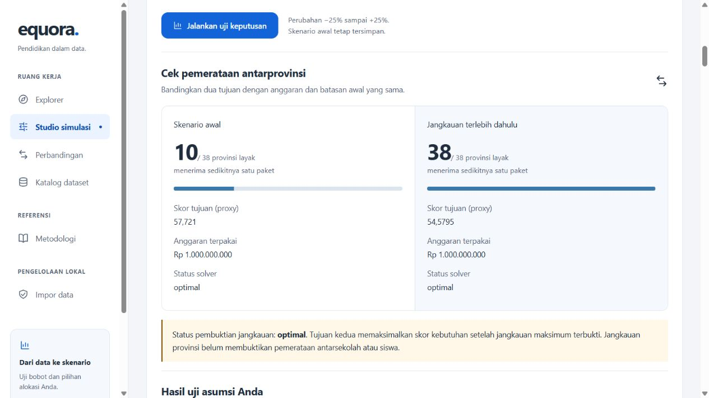

# Uji Keputusan Equora

Implementasi dan pemeriksaan lokal: 22 Oktober 2026. Rancangan:
[spesifikasi](superpowers/specs/2026-10-22-decision-review-design.md).

## Cara menggunakan

1. Buka Studio simulasi, atur kebutuhan dan anggaran, lalu simpan skenario.
2. Pada hasil skenario, pilih **Uji keputusan & pemerataan**.
3. Ubah anggaran, biaya, atau bobot relatif hingga +/-25%, lalu jalankan uji.
4. Bandingkan jangkauan awal dan jangkauan maksimum, hasil asumsi Anda, serta
   rentang paket/peringkat dari percobaan otomatis +/-10%.
5. Pilih percobaan untuk melihat selisih per provinsi. Unduh bukti JSON untuk
   menyimpan snapshot lengkap, parameter, solver, hasil, dan sumber bersama-sama.
6. Pilih **Telusur bukti** untuk menelusuri nilai akses, bobot, kontribusi skor,
   biaya/kapasitas, sel XLSX, definisi, periode, checksum, dan URL sumber.

Halaman dapat dibaca tanpa login di lingkungan lokal. Tautan snapshot menyimpan
skenario awal; uji tambahan dihitung saat diminta dan disimpan oleh pengguna lewat
unduhan JSON. Membuka ulang tautan tidak memulihkan hasil uji tambahan otomatis.
PDF/CSV snapshot awal tetap tersedia sebagai laporan skenario tersebut.

## Perhitungan

POST `/api/v1/scenarios/{snapshot_id}/review` menerima:

```json
{
  "budget_change_percent": 10,
  "cost_change_percent": 0,
  "weight_indicator": "sanitation_percent",
  "weight_change_percent": 0
}
```

Perubahan biaya diterapkan pada biaya default dan override wilayah, dibulatkan
HALF_UP ke rupiah (minimum Rp1). Perubahan bobot bersifat relatif: bobot 25% naik
10% menjadi 27,5 sebelum seluruh bobot dinormalisasi kembali ke total satu.
Bobot positif yang kecil tetap aktif; bobot nol tetap nol.

Uji otomatis menjalankan anggaran +/-10%, biaya +/-10%, dan tiap bobot positif
+/-10% satu per satu. Dengan empat bobot positif terdapat 12 percobaan. Kasus
tidak valid dan tidak ada solusi ditandai, tidak dianggap alokasi stabil.
Parameter percobaan dan status solver tersedia di JSON; angka rentang bukan
probabilitas atau interval kepercayaan. Optimum ganda dapat mengubah paket tanpa
mengubah skor tujuan.

Pilihan jangkauan menggunakan dua tahap CP-SAT: maksimalkan jumlah provinsi yang
menerima paling sedikit satu paket; jika maksimum terbukti, kunci jumlah tersebut
dan maksimalkan skor kebutuhan. Anggaran, biaya, kapasitas, minimum, dan cakupan
identik dengan skenario awal. Evaluasi independen memeriksa biaya, batas paket,
dan jumlah penerima. Jika tahap kedua kehabisan waktu, hasil tahap pertama yang
valid tetap tersedia sebagai feasible, dengan bound skor yang tidak tersedia.
Jangkauan optimal ditampilkan terpisah dari status optimasi skor kebutuhan.

Review tidak membaca rilis terbaru atau menulis database. Input dan sumber
diambil dari snapshot. Versi metode/model yang tidak kompatibel ditolak. Satu
detik solver per percobaan; pilihan jangkauan membagi satu detik antara dua tahap.
Biaya/kapasitas tetap asumsi demo. Jangkauan antarprovinsi tidak membuktikan
pemerataan antarsekolah, manfaat bagi siswa, atau kelayakan kebijakan.

## Bukti data lokal

Skenario lokal yang sudah tersimpan:
`ba58d6be-9223-4492-80d3-e33536d9dba6`, rilis
`local-2025-17dbcce0abdbebbc`, jenjang SD, anggaran Rp1.000.000.000,
biaya default Rp10.000.000, kapasitas 10 dan minimum 0 per provinsi.

| Ukuran | Awal | Jangkauan terlebih dahulu |
|---|---:|---:|
| Provinsi layak | 38 | 38 |
| Provinsi penerima | 10 | 38 |
| Total paket | 100 | 100 |
| Anggaran terpakai | Rp1.000.000.000 | Rp1.000.000.000 |
| Objective integer | 577210 | 545795 |
| Status | optimal | optimal |

Semua 14 alokasi (pilihan asumsi, jangkauan, dan 12 variasi otomatis) memenuhi
pemeriksaan ulang biaya, minimum, dan kapasitas. GET snapshot sebelum/sesudah
review identik, SHA-256 respons:
`fbe9ab0e9f39e31940a48559c8c0483071e8d1dabb53d4e39fec76be829663f9`.
Satu pengamatan API lokal memerlukan 0,136 detik; ini bukan benchmark performa.



## Pengujian

- Seluruh suite backend dengan PostgreSQL `equora_test`: 158 lulus sebelum satu
  kasus fallback tahap kedua ditambahkan. Suite review terakhir: 26 lulus,
  termasuk kasus fallback tersebut, enumerasi kecil, trade-off, override,
  normalisasi, missing, timeout, validasi rute, dan snapshot PostgreSQL tetap.
- Frontend: `pnpm run check` tanpa error/peringatan; `pnpm run check:api` sinkron;
  build produksi lulus. Lima unit test lokal lulus (termasuk modul basemap lokal).
- `pnpm exec playwright test --workers=1`: 33 lulus, termasuk empat tes baru
  review pada 390/1440px, bukti sumber, unduhan JSON, retry, keyboard, dan respons
  terlambat setelah berpindah halaman.
- Percobaan paralel pertama mengalami timeout 5 detik pada tes basemap lokal yang
  sudah ada; percobaan dua worker mengalami proses worker Windows berhenti sebelum
  tes dimulai. Suite berurutan di atas lulus tanpa retry. Perubahan basemap lokal
  bukan bagian PR ini; CI branch menjalankan 29 tes tanpa empat tes basemap itu.
- Lint/format Python, pemeriksaan tautan Markdown, dan whitespace diperiksa.
  Peringatan deprecation Starlette/httpx sudah ada; build juga melaporkan chunk
  besar pada renderer peta yang sudah ada.

## Pemeriksaan desain

- Hard Gate PASS: tes 390/1440px memeriksa overflow, label, error/retry, empty dan
  loading state, unduhan, tautan sumber, serta navigasi keyboard.
- Purpose Gate PASS: ikon slider menandai perubahan asumsi, chart hasil jangkauan,
  buku jejak sumber, dan download unduhan; semua memakai komponen ikon yang ada.
- Liveliness PASS: ENERGY 1 / RHYTHM 2 / MOTION 1 sesuai desain repo. Perbandingan
  jangkauan menjadi fokus hasil; panel angka, tabel, dan disclosure mengikuti
  kepadatan informasinya. Biru menandai tindakan; status selalu ditulis.
- Craftsmanship PASS: komponen memakai token warna/tipe repo, kontrol berlabel,
  status solusi eksplisit, dan data lokal/sintetis diberi konteks. Screenshot lokal
  di atas serta suite browser mendukung pemeriksaan visual dan fungsi.

Replit dicoba melalui konektor, tetapi akun belum terhubung. Implementasi memakai
komponen lokal dan tidak menambah dependensi frontend atau layanan hosting.
