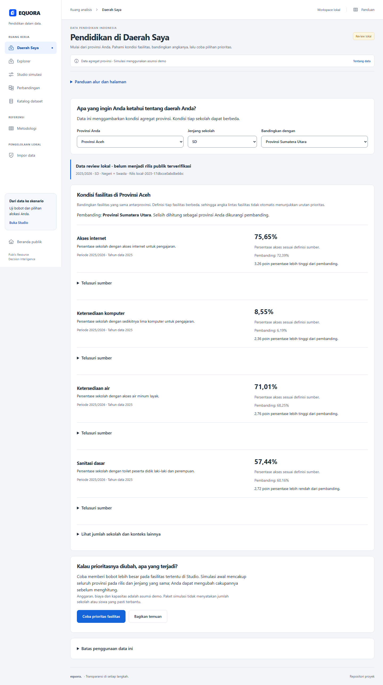
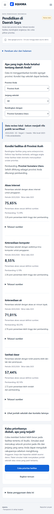

# Pendidikan di Daerah Saya

Implementasi lokal: 23 Oktober 2026. Tindak lanjut pemeriksaan dan perbaikan:
24 Oktober 2026.
[Rancangan](superpowers/specs/2026-10-23-pendidikan-daerah-saya-design.md) dan
[rencana implementasi](public-region-implementation-plan.md).

## Cara mencoba

1. Buka `/daerah` dari tindakan utama beranda atau menu Eksplorasi.
2. Pilih provinsi dan jenjang; baca definisi, nilai, periode dan status data.
3. Pilih satu provinsi pembanding. Selisih indikator yang sepadan ditulis dalam
   poin persentase, sebagai provinsi Anda dikurangi pembanding.
4. Buka **Telusuri sumber** untuk melihat definisi sumber, koordinat sel dan
   checksum. Jumlah sekolah tersedia dalam rincian konteks.
5. Pilih **Coba prioritas fasilitas** untuk membuka Studio pada rilis dan jenjang
   yang sama. Cakupan awal simulasi adalah seluruh provinsi pada jenjang itu.
6. Pilih **Bagikan temuan** untuk menyalin ringkasan dan tautan. Jika clipboard
   tidak tersedia, salin teks yang ditampilkan secara manual.

Parameter URL: `province`, `level`, `compare` opsional dan `release`. Tautan berbagi
selalu menyertakan rilis; rilis yang hilang tidak diganti otomatis. Pengguna dapat
memilih rilis aktif lewat tindakan terpisah pada halaman error.

## Pemeriksaan ulang 25 Oktober 2026

Pekerjaan dilanjutkan pada branch `feat/public-region-journey` dari `feat/clerk-auth`
(`9f1c800`). Saat mulai, alur publik, perubahan API serta tes sudah ada sebagai
perubahan lokal yang belum dikomit. Perubahan tersebut dipertahankan. Pemeriksaan
GitHub menemukan PR workspace #27–#32 dan auth #34 masih terbuka; pencarian PR
`daerah` tidak menemukan PR khusus fitur ini. Status lokal sudah diimplementasikan
tidak berarti fitur telah digabung ke main.

Perbaikan pada pemeriksaan ini:

- Respons profil memakai kontrak `RegionProfileView` di OpenAPI dan tipe frontend
  yang dihasilkan dari kontrak itu.
- Profil tanpa parameter rilis menulis rilis yang berhasil dimuat ke URL dengan
  mengganti entri riwayat, sehingga URL dapat dibuka ulang pada konteks yang sama.
- Detail teknis `/regions/[code]` membaca `release` dan `level`, menjaga respons
  terlambat, menyediakan retry dan meneruskan konteks ke profil publik.
- Penyusunan teks berbagi dipisahkan ke `profileSummary`, termasuk definisi,
  periode indikator, sumber, status, batas data dan URL dengan rilis.
- Studio membaca konteks URL secara reaktif. Pergantian jenjang memuat ulang
  daftar provinsi pada rilis yang sama, mengosongkan pilihan/override/hasil lama,
  dan menonaktifkan hitung selama cakupan dimuat. Kegagalan pemuatan provinsi
  menyediakan tindakan coba lagi.

Pemeriksaan tipe Svelte (tanpa error/peringatan), build produksi, sinkronisasi
OpenAPI, 11 unit test frontend serta Ruff untuk kedua file API yang berubah lulus.
Tes backend workspace tanpa database: 8 lulus dan 1 dilewati. Percobaan terpisah
pada database khusus `equora_test` gagal terhubung ke PostgreSQL lokal; bukti
integrasi database historis di bawah belum diverifikasi ulang pada sesi ini.

Seluruh 25 tes browser terfokus (`region-journey`, `workspace`, `public-access`)
lulus. Tes memakai fixture sintetis, termasuk mobile 390px dan desktop 1440px;
bukan bukti penerbitan data atau uji kegunaan dengan calon pengguna. Screenshot
profil/perbandingan pada kedua ukuran diperiksa secara visual. Pemeriksaan
whitespace pada file yang disentuh lulus; pemeriksaan seluruh working tree masih
menemukan whitespace lama pada `AnalysisJourney.svelte`, yang tidak diubah dalam
pekerjaan ini. Perubahan tetap lokal, tanpa commit, push atau publikasi.

## Batas penggunaan

Pengguna sasaran adalah publik yang ingin memahami kondisi daerahnya. Kegunaan
untuk siswa, mahasiswa, guru dan orang tua masih perlu diuji bersama calon pengguna.

Data workspace saat pemeriksaan berstatus `local_review`. Fitur dapat dicoba
lokal tanpa login; penerbitan rilis dan hosting publik belum dilakukan. Tautan
localhost hanya berlaku pada lingkungan lokal yang sesuai. Angka berasal dari
agregat provinsi, bukan diagnosis sekolah tertentu atau bukti penyebab kesenjangan.
Biaya dan paket simulasi tetap asumsi demo.

## Verifikasi

- Backend (23 Oktober): 200 tes lulus dengan koneksi khusus `equora_test`, termasuk pemilihan
  rilis tersimpan pada API profil; Ruff check dan format lulus. Kredensial test
  memakai `TEST_DATABASE_URL` lokal, terpisah dari role database aplikasi.
- Frontend: pemeriksaan Svelte tanpa error/peringatan, sembilan unit test lulus,
  build produksi lulus dan tipe OpenAPI sinkron.
- Lima tes browser fitur baru lulus: alur lengkap pada 390/1440px, pemulihan error
  rilis, metadata pembanding yang tidak cocok, clipboard berhasil/gagal, keyboard
  sumber, pemulihan tautan berbagi, serta respons profil yang terlambat.
- Pada 24 Oktober, seluruh 47 tes browser lulus dengan satu worker. Tes lama
  diselaraskan dengan UI saat ini: tautan **Telusur bukti data**, landing dengan
  ilustrasi sekolah, menu **Daerah Saya**, label admin, PDF dan pencarian katalog.
  Pengujian tetap memeriksa hasil perhitungan, unduhan bukti, error, keyboard,
  kondisi kosong, perbandingan serta tampilan mobile/desktop.
  Setelah koreksi terakhir pada badge baseline, pemeriksaan tipe dan build
  dijalankan ulang serta 17 tes Studio/workspace dan review keputusan lulus.
- Smoke test dengan API dan data lokal lulus: profil, pembanding, ringkasan,
  overflow 390/1440px, dan masuk Studio dengan tombol hitung aktif. Tidak ada
  skenario baru atau perubahan dataset dalam smoke test.

## Perbaikan lanjutan 24 Oktober

- Pencarian katalog memiliki label aksesibel **Cari judul atau penerbit**.
- Status `optimal` dan `feasible` memakai badge solusi pada ringkasan serta
  tabel baseline, sesuai nilai lowercase dari API.
- Ringkasan menghitung provinsi tanpa paket dari seluruh wilayah dalam model,
  termasuk ketika hasil alokasi tidak mencantumkan entri bernilai nol.
- Jumlah paket terbesar tidak otomatis disebut bukti kebutuhan tertinggi;
  penggunaan anggaran tidak disebut ukuran efisiensi; sisa anggaran tidak
  otomatis dijelaskan sebagai akibat kapasitas wilayah.
- Jangkauan antarprovinsi dibedakan dari pemerataan antarsekolah. Wilayah yang
  dikecualikan dari peringkat tetap disebut terpisah.

Tes regresi memakai skenario sintetis dengan dua wilayah dalam model, satu
penerima, satu alokasi nol yang tidak ditulis dalam dictionary, sisa anggaran,
dan status feasible. Kasus tersebut gagal sebelum perbaikan ringkasan dan lulus
setelahnya. Tidak ada perubahan model optimasi atau dataset.

## Pemeriksaan antarmuka fitur

- Hard Gate PASS: tes browser memeriksa mobile/desktop tanpa overflow, loading,
  error/retry, keadaan belum memilih provinsi, sumber, dan kontrol keyboard.
- Purpose Gate PASS: kontrol memakai komponen serta token biru-putih yang ada;
  warna biru menandai tindakan utama. Tidak ada aset atau klaim statistik buatan.
- Liveliness PASS: ENERGY 1 / RHYTHM 2 / MOTION 1 mengikuti workspace; pilihan
  provinsi menjadi fokus awal, kemudian nilai fasilitas dan perbandingannya.
- Craftsmanship PASS: missing dan denominator nol tidak ditampilkan sebagai 0%
  akses; versi, sumber dan status lokal terlihat. Screenshot data lokal diperiksa.

