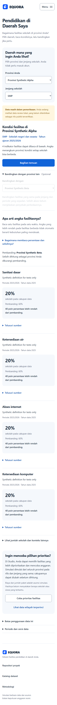
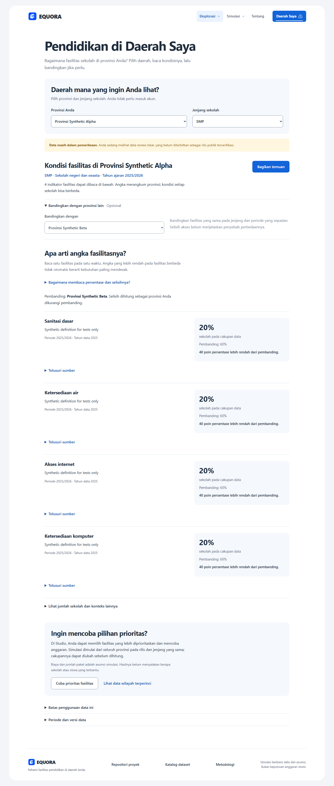

# Perbaikan UI untuk publik

25 Oktober 2026. Branch: `feat/public-region-journey`.

## Arah

Pengguna memilih provinsi dan jenjang, membaca kondisi, lalu memilih apakah perlu
membandingkan, membuka sumber, membagikan temuan atau mencoba simulasi. Halaman
Daerah Saya memakai navigasi publik. Halaman analisis tetap memakai workspace.
Identitas Clean Education Blue yang sudah disetujui dipertahankan.

## Perubahan

- `/daerah`: pembuka dengan pertanyaan langsung, dua pilihan awal, konteks sekolah
  dan periode, keterangan kelengkapan data, serta penjelasan cara membaca persen.
  Pembanding opsional; rincian verifikasi berkas dibuka setelah rincian sumber.
  Data review, nilai kosong, ketidakcocokan perbandingan dan batas interpretasi
  tetap terlihat pada tempat yang relevan. Tautan detail teknis membawa konteks.
- Beranda dan navigasi publik mengutamakan Daerah Saya. Explorer, katalog,
  metodologi, Studio dan perbandingan skenario tetap dapat diakses.
- Tombol bersama minimal 48px, pilihan Daerah Saya 52px, checkbox 24px dengan label
  minimal 48px, dan kontrol peta 44px. Tombol kecil pada skenario tersimpan serta
  katalog diperbesar. Isian bersama memakai ukuran teks 16px.
- Studio memakai istilah anggaran simulasi, maksimum/minimum paket per provinsi,
  petunjuk batas paket dan penjelasan bobot dalam bahasa sehari-hari. Pencarian
  provinsi memiliki label aksesibel.
- Menu workspace pada HP menjaga fokus di dalam navigasi, menonaktifkan interaksi
  halaman di belakangnya, dan mengembalikan fokus setelah ditutup dengan Escape.
  Menu ditutup ketika viewport kembali ke ukuran desktop.

Pemilihan provinsi/jenjang, respons terlambat, pemeriksaan kompatibilitas,
provenance, clipboard fallback, URL dan penerusan rilis ke Studio tetap memakai
kontrak yang sudah ada. Tidak ada perubahan rumus analisis atau publikasi data.

## Pemeriksaan

- Svelte check: tanpa error/peringatan. Sebelas unit test frontend lulus. Tipe API
  tetap sinkron dengan OpenAPI.
- Build produksi berhasil memakai Node dengan batas heap 384 MB dan satu thread
  Rayon. Dua percobaan awal berhenti akibat kekurangan memori komputer; tidak ada
  perubahan konfigurasi build permanen untuk mengatasi kondisi lingkungan ini.
- Seluruh 60 tes browser lulus dengan satu worker. Tes mencakup alur publik pada 360/390/768/1440px, kontrol utama di delapan
  halaman pada 360/1440px, navigasi, keyboard, sumber, retry, berbagi, rilis dan
  simulasi. Screenshot profil pada HP dan desktop diperiksa secara visual.
- Kontras teks sekunder pada permukaan terang 5,84:1; putih pada tombol biru
  5,47:1; teks status review 5,26:1; teks biru pada tint 6,81:1. Batas kontrol pada
  putih 3,38:1 memenuhi batas nonteks 3:1. Pemeriksaan ini tidak merupakan audit
  aksesibilitas menyeluruh.
- Detektor desain dijalankan. Aksen border tebal pada notice lama dihapus; font
  baseline dipertahankan agar identitas aplikasi tetap konsisten.

Validasi browser memakai data sintetis. Pengujian kegunaan dengan calon pengguna
dan validasi integrasi PostgreSQL masih merupakan tindak lanjut tersendiri.
Semua perubahan workspace sebelumnya dipertahankan; perubahan tetap lokal.

## Tampilan yang diperiksa

Screenshot berikut memakai fixture sintetis, bukan angka kondisi provinsi nyata.

