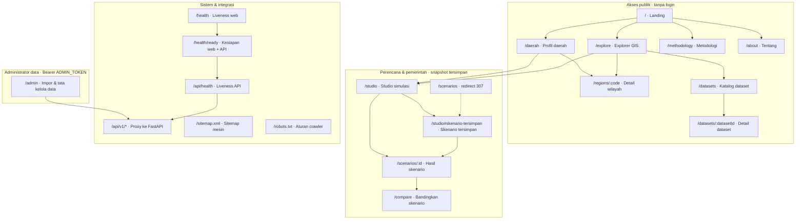
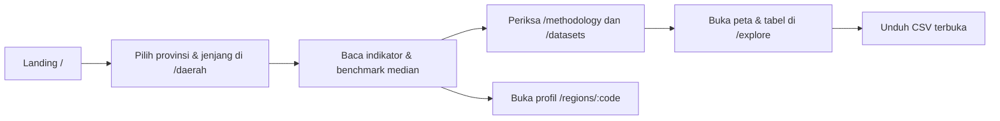
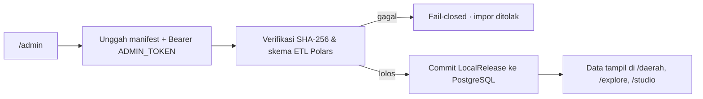

# Peta Situs, Alur Peran, dan Wireframe

Dokumen ini menjawab aspek **Kejelasan Struktur (Sitemap & Wireframe)** dan **Validasi Alur Pengguna (User Flow)** pada evaluasi FDS Web In Action (WIA) 2026.

Semua rute di bawah sudah diimplementasikan di `frontend/src/routes`. Rute yang membutuhkan data memerlukan backend aktif (`API_BASE_URL`).

## 1. Peta situs

## 2. Alur pengguna per peran

### Masyarakat umum — eksplorasi terbuka

Batasan: tanpa login, hanya membaca rilis data aktif, tidak dapat mengubah data dasar.

### Perencana & pemerintah — simulasi kebijakan

```mermaid
flowchart LR
  A["/explore atau /daerah"] --> B["/studio · atur bobot MCDA, anggaran, biaya, kapasitas"]
  B --> C["Hasil skor kebutuhan MCDA & alokasi CP-SAT"]
  C --> D["#peta-urgensi · peta tingkat urgensi & sebaran alokasi"]
  D --> E["Simpan snapshot (release_id)"]
  E --> F["/scenarios/:id · hasil tersimpan"]
  F --> G["/compare · bandingkan dua skenario"]
  G --> H["Unduh Memo Kebijakan PDF"]
```

Batasan: menyimpan snapshot skenario tanpa mengubah data dasar; hasil simulasi bukan keputusan anggaran resmi.

### Administrator data — impor & tata kelola

Batasan: endpoint `POST /api/v1/admin/import` hanya menerima token admin; berkas yang gagal verifikasi ditolak otomatis.

## 3. Struktur navigasi

| Grup navigasi | Item | Rute |
| --- | --- | --- |
| Publik | Cara Kerja | `/methodology` |
| Publik | Tentang | `/about` |
| Publik | Mulai Eksplorasi (CTA utama) | `/explore` |
| Eksplorasi | Explorer | `/explore` |
| Eksplorasi | Pendidikan di Daerah Saya | `/daerah` |
| Simulasi | Studio simulasi | `/studio` |
| Simulasi | Skenario tersimpan | `/studio#skenario-tersimpan` |
| Simulasi | Bandingkan | `/compare` |
| Referensi | Metodologi | `/methodology` |
| Referensi | Katalog dataset | `/datasets` |
| Area terbatas | Impor data | `/admin` |

Sumber kebenaran navigasi: `frontend/src/lib/api/workspace.ts` (`publicNavLinks`, `workspaceNavGroups`) dan `frontend/src/lib/components/WorkspaceShell.svelte`.

## 4. Wireframe & mockup

| Halaman | Aset | Blok utama | Aksi utama |
| --- | --- | --- | --- |
| Landing `/` | [`wireframe_equora.png`](wireframe_equora.png), [`wireframe_preview.html`](wireframe_preview.html) | Header, hero, alur 3 langkah, blok skenario, kartu peran, sumber indikator, metode | `/daerah`, `/explore` |
| Profil daerah `/daerah` | Screenshot di deck presentasi | Filter provinsi & jenjang, kartu indikator, benchmark median, tabel pembanding, tautan sumber | `/regions/:code`, `/studio` |
| Explorer GIS `/explore` | Screenshot di deck presentasi | Peta choropleth, legenda, filter indikator/wilayah, tabel provinsi, ekspor CSV | `/regions/:code`, `/studio` |
| Studio `/studio` & `/scenarios/:id` | Screenshot di deck presentasi | Panel bobot MCDA, anggaran & kapasitas, ringkasan hasil, `#peta-urgensi` | Simpan snapshot, `/compare` |
| Admin `/admin` | Screenshot di deck presentasi | Unggah manifest, log audit ETL, matriks peran & keamanan | `POST /api/v1/admin/import` |

Wireframe interaktif: buka [`wireframe_preview.html`](wireframe_preview.html) di browser. Versi gambar: [`wireframe_equora.png`](wireframe_equora.png). Tangkapan layar tiap halaman tersedia di deck presentasi submisi.

## 5. Catatan konsistensi

- `/scenarios` bukan halaman mandiri; ia mengalihkan (307) ke `/studio#skenario-tersimpan`.
- Rute `/health` memeriksa server web, sedangkan `/health/ready` dan `/api/health` memeriksa koneksi ke backend.
- Peta menggunakan agregat **provinsi**, bukan titik lokasi sekolah individual.
- Semua fitur publik dapat diakses tanpa login; fitur berbasis data memerlukan backend dan rilis lokal yang aktif.
